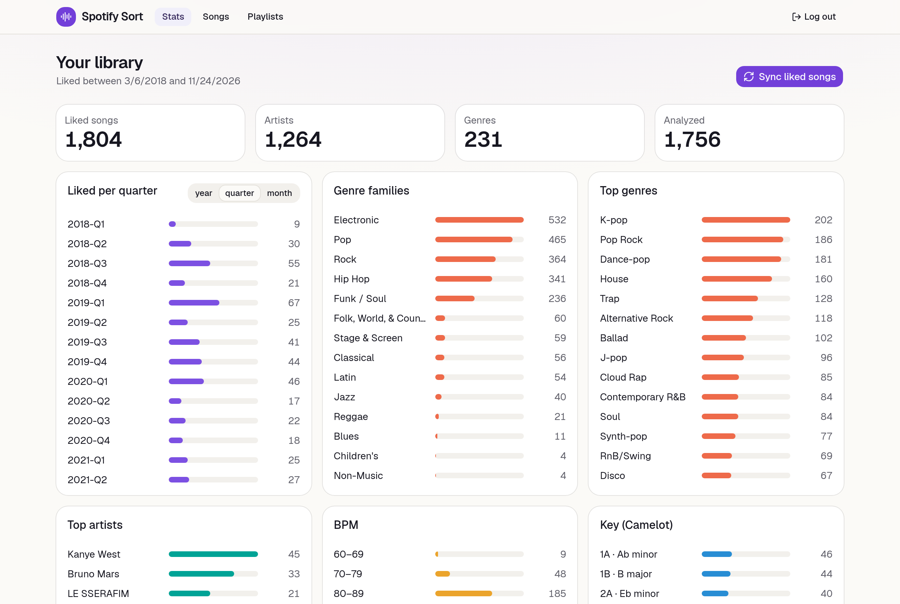
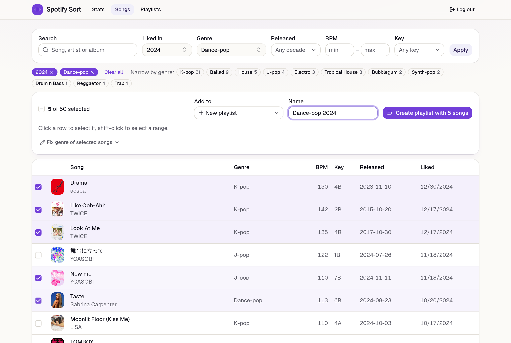
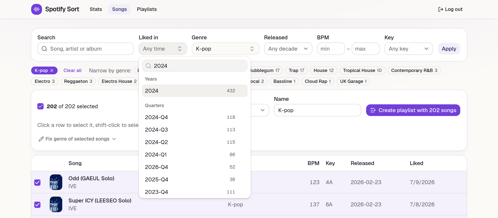
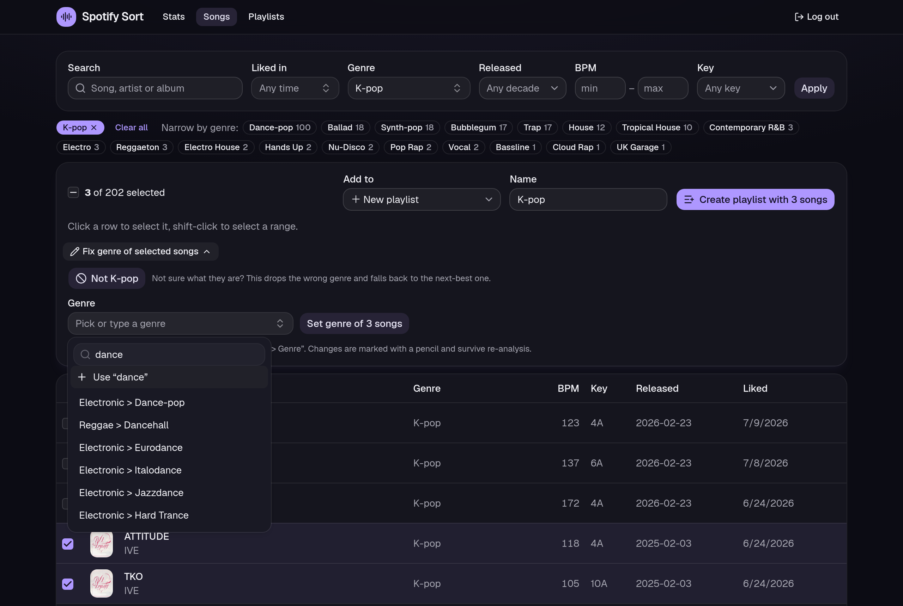
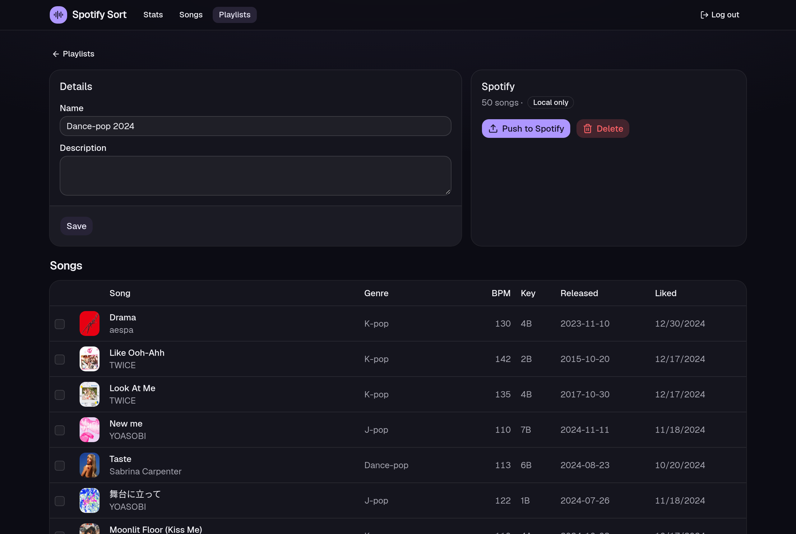

<div align="center">

# Spotify Sort

**See what you've been liking, and turn it into playlists.**

Pull your Spotify liked songs into a local database, explore them by month, quarter or year, genre, BPM and key, build playlists from any slice, then push the ones you like back to Spotify.

Runs entirely on your own machine. No hosted service and no account besides your own Spotify app.



</div>

## What you can do

### 📊 See your library at a glance

Liked songs per year, quarter or month, plus genre families, top genres, top artists, BPM, musical key (with [Camelot](https://mixedinkey.com/camelot-wheel/) numbers for harmonic mixing) and release decades. Every bar is a link to those songs.

### 🎛️ Slice it any way you want

Combine filters for when you liked a song, genre, release decade, BPM range, key and free text. Then select the songs you want (click, shift-click for a range, or all at once) and create a playlist or add them to an existing one. Songs already in the target playlist are marked, so you never add duplicates.



Every dropdown is searchable and shows how many songs are behind each option.



### 🏷️ Fix wrong genres

Genres are predicted from the audio, so some will be wrong. Select the songs and either:

- **Not this genre**: you know it's wrong but not what it should be. The song falls back to its next-best detected genre.
- **Set genre**: pick an existing genre or type a new one (`Family > Genre`).

Your fixes are marked with a pencil and survive re-analysis. **Reset to detected** undoes them.

Regional genres like K-pop and J-pop describe where an artist is from, which the audio can't tell you. So they only stick when one of the song's artists is actually from that country, looked up on [MusicBrainz](https://musicbrainz.org). Sabrina Carpenter stops showing up as K-pop.



### 🚀 Push to Spotify when you're ready

Playlists live locally until you press **Push to Spotify**, which creates them as private playlists. A badge shows whether a playlist is local only, on Spotify, or changed since the last push.



Light and dark mode follow your system setting.

## Quick start

**You need:**
- Node 24+
- A Spotify **Premium** account (Spotify requires it for developer apps)
- For audio analysis: [uv](https://docs.astral.sh/uv/) and `ffmpeg`

**1. Create a Spotify app** at <https://developer.spotify.com/dashboard>:
- Redirect URI: `http://127.0.0.1:5173/callback` (Spotify rejects `localhost`, so use the IP)
- API: Web API

**2. Configure.** Copy the example env file and paste in your app's **Client ID**:

```sh
cp .env.example .env
```

No client secret is needed, because login uses PKCE. If you prefer the client-secret flow, also set `SPOTIFY_CLIENT_SECRET`. It's only read on the server, and `.env` is git-ignored.

**3. Run it:**

```sh
npm install
npm run dev
```

Open <http://127.0.0.1:5173>, log in, and hit **Sync liked songs**.

**4. Analyze the audio** (optional, but it's where genres, BPM and key come from):

```sh
npm run analyze
```

This takes about 1 to 2 seconds per song and runs on your machine. You can stop it at any time and run it again to resume. At the end it looks up artist countries for regional genres.

## Where the data comes from

Spotify no longer gives developer apps genres or audio features, so the app pieces them together:

| Data | Source |
|---|---|
| Liked songs, dates, artists, albums | Spotify Web API |
| BPM, key and genre | [Essentia](https://essentia.upf.edu), running locally on each song's 30-second [Deezer](https://developers.deezer.com) preview (matched by ISRC). Genres are the [Discogs 400 styles](https://essentia.upf.edu/models.html#discogs-effnet) predicted from the audio |
| Energy, mood, danceability | [ReccoBeats](https://reccobeats.com), for songs it knows |
| Artist country (for K-pop, J-pop and other regional genres) | [MusicBrainz](https://musicbrainz.org) |

**Privacy:**
- Your data stays in a SQLite file in `data/`, which is git-ignored.
- The analysis only sends song IDs, ISRCs, titles and artist names to Deezer, ReccoBeats and MusicBrainz. Nothing about your account is sent.
- Preview clips are deleted right after they're analyzed.

**Accuracy:** genre guesses come from 30 seconds of audio, so expect some misses, which is what the genre fixes are for. BPM can come out at double or half the real tempo.

## Commands

| Command | What it does |
|---|---|
| `npm run dev` | Start the app at <http://127.0.0.1:5173> |
| `npm run analyze` | Analyze new songs. Use `-- --limit 20` to try a few first, or `-- --retry` to retry failures |
| `npm run artists` | Look up artist countries only. Use `-- --recheck` to redo all of them |
| `npm test` | Run the query tests (in-memory SQLite) and the analysis helper self-checks |
| `npm run check` | Type-check |

## Built with

[SvelteKit](https://svelte.dev) · [shadcn-svelte](https://shadcn-svelte.com) · [Tailwind CSS](https://tailwindcss.com) · `node:sqlite` · [Essentia](https://essentia.upf.edu) (Python, via uv)

## Good to know

- **Each user needs their own Spotify app.** Spotify developer apps in development mode allow up to 5 users per Client ID.
- **Pushing again overwrites.** Pushing a playlist that's already on Spotify replaces the Spotify copy with your local list.
- **Licenses of the analysis tools:** Essentia is AGPL-3.0, and its models are CC BY-NC-SA 4.0 (non-commercial). They're downloaded when you run the analysis and aren't bundled with this repo.
- **Not affiliated with Spotify.** This is a personal project.
